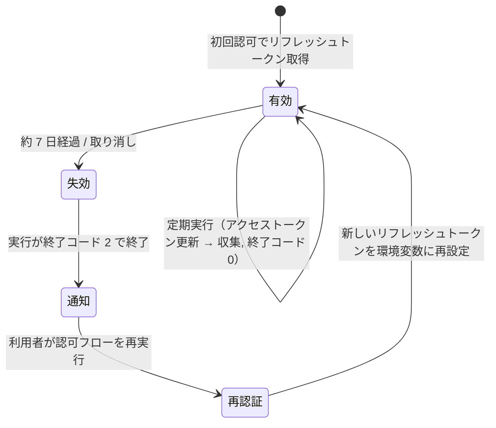

# morning-collector

Google Health API（Fitbit の後継 API, v4）から睡眠・健康データを取得し、Turso（libSQL）に蓄積する単一バイナリです。
cron / systemd timer などから定期実行する想定で、**起動 → 収集 → 終了** の 1 回実行型です。書き込みはすべて upsert のため、同じ期間を何度実行しても結果は同じ（冪等）です。

> 現状は骨格のみです。OAuth によるアクセストークン取得はスタブのため、実行すると DB 初期化後に終了コード 1 で終了します（次 PR で本実装）。

## 実行方法

```sh
cd collector
cargo build --release

# 通常実行（今日を含む直近 3 日分）
./target/release/morning-collector

# 取得日数を変える
./target/release/morning-collector --days 7

# バックフィル（指定日〜今日）
./target/release/morning-collector --from 2026-01-01
```

| 引数 | 説明 | デフォルト |
| --- | --- | --- |
| `--from YYYY-MM-DD` | バックフィル開始日。指定時は この日〜今日 を取得（`--days` より優先） | なし |
| `--days N` | 今日を含めて遡って取得する日数（1 以上） | `3` |

日付は実行環境のローカルタイムゾーンで「今日」を決めます。睡眠は起床日、運動は開始日、日次指標は API の日付で範囲指定します。

## 環境変数

設定は**環境変数からのみ**読み込みます（`.env` などのファイルは読みません）。値をリポジトリ内のファイルに置かず、シークレットマネージャやリポジトリ外のファイル（権限 600）から実行時に注入してください。

| 変数 | 必須 | 説明 |
| --- | --- | --- |
| `GOOGLE_CLIENT_ID` | ○ | OAuth クライアント ID |
| `GOOGLE_CLIENT_SECRET` | ○ | OAuth クライアントシークレット |
| `GOOGLE_REFRESH_TOKEN` | ○ | 初回認可で得たリフレッシュトークン |
| `TURSO_DATABASE_URL` | – | 例: `libsql://<db>-<org>.turso.io`。未設定ならローカルファイル `./morning-local.db` を使用。`file:<path>` でローカルファイルを指定可 |
| `TURSO_AUTH_TOKEN` | リモート時 ○ | Turso の認証トークン |

## 書き込み先テーブル

起動時に `CREATE TABLE IF NOT EXISTS` で作成します。

| テーブル | 一意キー | 取得元データ型 |
| --- | --- | --- |
| `sleep_sessions` | `point_name` | `sleep` |
| `exercises` | `point_name` | `exercise` |
| `daily_metrics` | `date` | `daily-heart-rate-variability` / `daily-oxygen-saturation` / `daily-resting-heart-rate` |

`daily_metrics` は複数のデータ型から列ごとに埋まるため、upsert 時に NULL で既存値を上書きしません。`steps` 列の集計は次 PR 以降で実装します。

## 終了コード

| コード | 意味 | 運用上の対応 |
| --- | --- | --- |
| `0` | 成功 | – |
| `2` | 認証失効（リフレッシュトークン失効・取り消し、API の 401） | 通知して再認証する |
| `1` | その他の失敗（引数・設定不備、ネットワーク、API エラー、DB エラーなど） | ログを確認。一時的な失敗なら次回実行で回復 |

## トークン管理の状態遷移

OAuth 同意画面が「テスト」状態のアプリでは、リフレッシュトークンは約 7 日で失効します。失効を終了コード 2 で検知し、通知 → 再認証で復旧します。



## 開発

```sh
cargo build
cargo test
cargo clippy --all-targets -- -D warnings
cargo fmt --check
```

- `tests/fixtures/` に API レスポンス形の JSON（睡眠の本睡眠・昼寝、HRV、SpO2、安静時心拍、運動）を置き、`tests/fixtures_parse.rs` でパースと行変換を検証しています。フィクスチャはダミー値です。
- Health API は int64 を JSON 文字列（例: `"minutes": "217"`）で返すため、`src/health/de.rs` のデシリアライザで文字列・数値の両方を受けます。
- `TURSO_DATABASE_URL` を設定しなければローカルファイル DB で動作確認できます。
